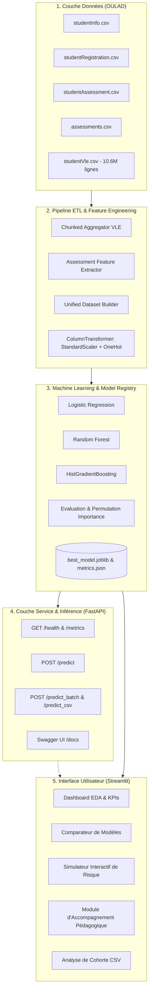
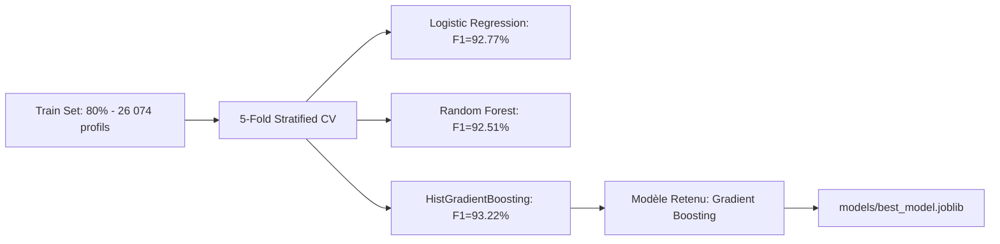

# Architecture Technique du Projet EduAccess

## 1. Vue d'Ensemble du Système

Le projet **EduAccess** est conçu selon une architecture modulaire en couches, garantissant une séparation nette des responsabilités, la reproductibilité des expérimentations de Machine Learning, et la facilité de maintenance et de déploiement.

---

## 2. Description des Couches

### 2.1. Couche Données (ETL & Aggregation)
- **Source** : Dataset OULAD (Open University Learning Analytics Dataset).
- **Problématique volume** : `studentVle.csv` contient plus de 10,6 millions d'interactions individuelles (453 Mo).
- **Solution technique** : Traitement par morceaux (*chunking* avec taille de lot de 1 000 000 lignes) avec `pandas`, extrayant spécifiquement les clics pré-cours (`date < 0`), les clics précoces (`date <= 30`), et les jours de connexion distincts.
- **Résultat** : Génération d'un fichier intermédiaire consolidé `data/processed_students.csv` (32 593 lignes, 26 colonnes), réduisant le temps de chargement de 15 secondes à 0.1 seconde.

### 2.2. Couche Feature Engineering
- **Catégorielles** : `code_module`, `gender`, `region`, `highest_education`, `imd_band`, `age_band`, `disability`. Encodées via `OneHotEncoder(handle_unknown='ignore', sparse_output=False)`.
- **Numériques** : 15 indicateurs d'engagement et de réussite (clics VLE, notes d'évaluations, retards de soumission, charge de crédits, date d'inscription). Normalisées via `StandardScaler()`.
- **Prévention du Data Leakage** : Exclusion stricte de `date_unregistration` (qui constitue l'effet de l'abandon plutôt qu'une cause prédictive).

### 2.3. Couche Modélisation & Évaluation
Trois familles d'algorithmes ont été comparées sous validation croisée stratifiée 5-folds :
1. **Régression Logistique** : Modèle linéaire de référence (baseline rapide et interprétable).
2. **Random Forest** : Modèle ensembliste par bagging non linéaire.
3. **HistGradientBoosting** : Modèle ensembliste par boosting d'arbres, état de l'art sur données tabulaires.

### 2.4. Couche Exposition API (FastAPI)
- **Protocole** : REST HTTP avec validation Pydantic v2.
- **Documentation interactive** : Swagger UI sur `/docs` et Redoc sur `/redoc`.
- **Gestion du cycle de vie** : Chargement singleton du modèle via le gestionnaire de contexte `lifespan`.
- **Fonctionnalités clés** :
  - Inférence unitaire en temps réel (`POST /predict`).
  - Inférence en lot pour plusieurs étudiants (`POST /predict_batch`).
  - Scoring de cohortes entières par import de fichier (`POST /predict_csv`).
  - Monitoring des performances et de l'état du système (`GET /health`, `GET /metrics`).

### 2.5. Couche Interface Utilisateur (Streamlit)
- Tableau de bord réactif en Python pur.
- Composants graphiques interactifs propulsés par **Plotly**.
- Simulateur de détection précoce intégrant une jauge de risque dynamique et un moteur de règles générant des **recommandations d'accompagnement pédagogique individualisées**.

---

## 3. Matrice de Traçabilité des Données

| Entité | Table Source OULAD | Variable Générée | Rôle Pédagogique |
| :--- | :--- | :--- | :--- |
| **Profil Personnel** | `studentInfo.csv` | `age_band`, `highest_education`, `disability` | Identifier les profils nécessitant des aménagements spécifiques. |
| **Inscription** | `studentRegistration.csv` | `date_registration` | Détecter les inscriptions tardives à risque de décrochage. |
| **Engagement Numérique** | `studentVle.csv` | `pre_course_clicks`, `early_30_clicks` | Signal faible d'isolement ou de désengagement précoce. |
| **Régularité Éducative** | `studentAssessment.csv` | `early_avg_score`, `early_late_submissions` | Détection des blocages méthodologiques et lacunes initiales. |
| **Cible d'Alerte** | `studentInfo.csv` | `is_at_risk` (1 = Fail/Withdrawn, 0 = Pass/Distinction) | Déclenchement de l'intervention tutorale bienveillante. |
