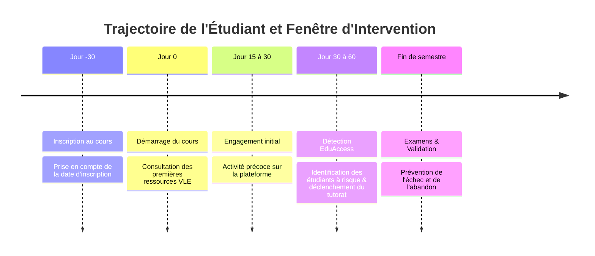

# Support Pédagogique : Détection Précoce des Difficultés d'Apprentissage (Projet EduAccess)

**Module :** Développement et déploiement d’applications intelligentes  
**Établissement :** École Marocaine des Sciences de l'Ingénieur (EMSI)  
**Enseignante :** Pr. Soukaina Gouraguine  
**Projet :** PROJET 1 — EduAccess  

---

## 1. Introduction & Contexte : Le Learning Analytics

### 1.1. Qu'est-ce que le Learning Analytics ?
La *Society for Learning Analytics Research* (SoLAR) définit le **Learning Analytics** comme la mesure, la collecte, l'analyse et la communication de données relatives aux apprenants et à leurs contextes, dans le but de **comprendre et d'optimiser l'apprentissage** et les environnements dans lesquels il se déroule.

Dans les établissements d'enseignement supérieur et les plateformes de formation en ligne (LMS / VLE), le taux d'abandon en première année ou dans les cours à distance oscille souvent entre 20% et 50%. Les causes sont multiples : sentiment d'isolement, charge de travail mal anticipée, prérequis non maîtrisés ou manque d'organisation temporelle.

### 1.2. La Détection Précoce : Principe du "Early Warning System" (EWS)
Le concept central du projet EduAccess est l'**intervention précoce** :
- **Constat traditionnel :** Les difficultés académiques ne sont constatées qu'après les examens finaux, lorsqu'il est trop tard pour agir.
- **Approche prédictive EduAccess :** Identifier les signaux faibles dès les 30 à 60 premiers jours du cours (activité de navigation, participation, premières évaluations) pour déclencher un accompagnement humain proactif.

---

## 2. Le Jeu de Données : OULAD (Open University Learning Analytics Dataset)

L'OULAD est l'un des jeux de données de référence au niveau mondial dans la recherche en informatique éducative. Il regroupe les données de **32 593 étudiants** inscrits sur 22 présentations de 7 modules d'enseignement dispensés par l'Open University au Royaume-Uni.

### 2.1. Les 7 tables relationnelles
1. **courses.csv** : Identifiants des modules et présentations (sessions de février "B" et octobre "J").
2. **assessments.csv** : Liste des 206 évaluations, leurs dates limites et coefficients.
3. **vle.csv** : 6 364 ressources pédagogiques hébergées (forums, quiz, pages HTML, vidéos, wikis).
4. **studentInfo.csv** : Données sociodémographiques et résultat final de l'étudiant.
5. **studentRegistration.csv** : Dates d'inscription et éventuelle date de désinscription.
6. **studentAssessment.csv** : 173 912 soumissions de devoirs avec notes obtenues (0 à 100).
7. **studentVle.csv** : Plus de **10,6 millions d'interactions** quotidiennes journalisées.

### 2.2. Prévention rigoureuse du Data Leakage (Fuite d'Information)
Une erreur méthodologique majeure consisterait à utiliser la colonne `date_unregistration` de `studentRegistration.csv`. En effet, la présence d'une date de désinscription signifie par définition que l'étudiant a abandonné (`Withdrawn`). Dans EduAccess, cette variable est **strictement exclue** des variables explicatives pour garantir un modèle de détection précoce réaliste et généralisable.

---

## 3. Méthodologie de Modélisation & Machine Learning

### 3.1. Formulation du Problème
Le problème est formulé sous la forme d'une **classification supervisée binaire** :
- **Classe 1 (À Risque) :** Étudiants ayant échoué (`Fail`) ou abandonné (`Withdrawn`) $\rightarrow$ 52.8% de la population.
- **Classe 0 (En Réussite) :** Étudiants ayant validé (`Pass`) ou obtenu une mention (`Distinction`) $\rightarrow$ 47.2% de la population.

La cible est naturellement bien équilibrée, évitant les écueils des données fortement asymétriques.

### 3.2. Comparaison des Algorithmes
Conformément au cahier des charges, trois algorithmes complémentaires ont été entraînés et comparés :

1. **Régression Logistique (Baseline linéaire)** :
   $$P(Y=1|X) = \frac{1}{1 + e^{-(\beta_0 + \beta^T X)}}$$
   - *Avantages :* Interprétabilité directe des coefficients, rapidité extrême d'inférence.
   - *Limites :* Hypothèse de linéarité dans l'espace des log-odds, incapable de capturer des interactions complexes sans termes croisés.

2. **Random Forest (Bagging d'arbres décisionnels)** :
   - Agrège les prédictions d'une assemblée d'arbres de décision décorrélés entraînés sur des sous-échantillons bootstrap.
   - *Avantages :* Excellente robustesse au surapprentissage, non-linéarité native.

3. **HistGradientBoosting (Boosting séquentiel)** :
   - Construit itérativement des arbres en minimisant la fonction de perte par descente de gradient, avec discrétisation en histogrammes (inspiré de LightGBM).
   - *Avantages :* Précision de pointe sur données tabulaires, temps d'entraînement très court, gestion native des non-linéarités.

### 3.3. Résultats Comparatifs Obtenus

| Modèle | Accuracy (Test) | Précision (Risque) | Rappel (Risque) | F1-Score | ROC-AUC | F1-Score (5-Fold CV) |
| :--- | :---: | :---: | :---: | :---: | :---: | :---: |
| **Régression Logistique** | 92.77% | 95.64% | 90.44% | 92.97% | 0.9735 | 92.77% |
| **Random Forest** | 92.39% | 95.88% | 89.37% | 92.51% | 0.9787 | 92.51% |
| **Gradient Boosting (Retenu)** | **93.04%** | **95.88%** | **90.70%** | **93.22%** | **0.9812** | **93.22%** |

> **Choix du modèle :** **HistGradientBoosting** a été retenu comme modèle optimal en production car il maximise à la fois le F1-Score (93.22%) et l'AUC (0.9812), avec un excellent équilibre entre détection des profils en difficulté (rappel 90.7%) et fiabilité des alertes levées (précision 95.9%).

---

## 4. Choix des Technologies & Justification

| Composant | Technologie Retenue | Alternative Envisagée | Justification du Choix |
| :--- | :--- | :--- | :--- |
| **Langage** | Python 3.11/3.13 | R, Java | Écosystème leader en Data Science et IA, unifiant traitement, API et UI. |
| **Data Processing** | Pandas, NumPy | PySpark | Pandas gère parfaitement l'OULAD avec traitement par chunks de 1M de lignes en moins de 6 secondes. |
| **Machine Learning** | Scikit-learn | TensorFlow / Keras | Les modèles arborescents (Random Forest, Gradient Boosting) surpassent les réseaux de neurones denses sur données tabulaires hétérogènes de taille moyenne. |
| **API Backend** | FastAPI | Flask | Performances asynchrones supérieures, validation native des types avec Pydantic v2, documentation OpenAPI Swagger interactive générée automatiquement. |
| **Interface Frontend** | Streamlit | React, Dash | Prototypage rapide en Python pur, interactivité native, graphiques Plotly intégrés, prise en main immédiate pour les démonstrations pédagogiques. |
| **Tests & QA** | Pytest | Unittest standard | Syntaxe concise, fixtures puissantes, intégration avec `TestClient` FastAPI pour tester les endpoints HTTP sans lancer de serveur externe. |
| **Déploiement** | Docker & Compose | Machine virtuelle | Conteneurisation légère, isolation des dépendances, reproductibilité absolue sur n'importe quel système d'exploitation. |

---

## 5. Étude de Cas : Exemples Concrets d'Aide à l'Accompagnement

### Cas n°1 : Décrochage précoce lié à l'inactivité VLE
- **Profil :** Étudiant inscrit tardivement (+5 jours), 0 clic avant le début du cours, 25 clics lors des 30 premiers jours, premier devoir non validé (30/100).
- **Prédiction du système :** Probabilité de risque de **91.4%** (Niveau : **Élevé**).
- **Actions déclenchées :**
  1. Envoi d'une alerte au tuteur référent.
  2. Prise de contact bienveillante pour vérifier si l'étudiant rencontre des obstacles techniques d'accès à la plateforme.
  3. Proposition d'un créneau de tutorat méthodologique pour réexpliquer le premier devoir.

### Cas n°2 : Étudiant régulier mais surchargé
- **Profil :** 150 crédits simultanés (équivalent temps plein x 2.5), 2 devoirs rendus en retard, engagement VLE moyen.
- **Prédiction du système :** Probabilité de risque de **62.0%** (Niveau : **Modéré**).
- **Actions déclenchées :** Entretien d'orientation pour proposer un aménagement de calendrier ou un étalement des modules sur l'année suivante.

---

## 6. Limites Techniques et Cadre Éthique

### 6.1. Outil d'Aide à la Décision vs Décision Automatisée
Conformément au cahier des charges :
> *"Elle constitue un outil d'aide à l'analyse, et non un système de décision automatique concernant les étudiants."*

- **Principe de précaution :** Aucune sanction, aucun refus de passage ni exclusion ne peut être prononcé sur la base du score algorithmique.
- **Bénéfice exclusif :** Le modèle n'a vocation qu'à **proposer de l'aide supplémentaire**.
- **Supervision humaine :** Tout accompagnement est validé et piloté par un enseignant ou conseiller pédagogique.

### 6.2. Limites Techniques
1. **Effet Cold-Start (Démarrage à froid) :** Avant le premier jour de cours, le modèle ne dispose que des caractéristiques sociodémographiques et de l'inscription, ce qui limite le pouvoir discriminant. La précision s'accroît considérablement dès que les premières traces d'activité (clics et premier devoir) sont enregistrées.
2. **Spécificité du contexte d'apprentissage :** L'OULAD reflète l'enseignement à distance de l'Open University britannique. Un transfert direct vers un établissement présentiel ou hybride nécessite un réentraînement sur les données locales.
3. **Évolution des comportements :** Les habitudes de consultation des étudiants peuvent évoluer (utilisation de ressources externes comme YouTube, ChatGPT ou des manuels papier) qui ne génèrent pas de clics VLE.
